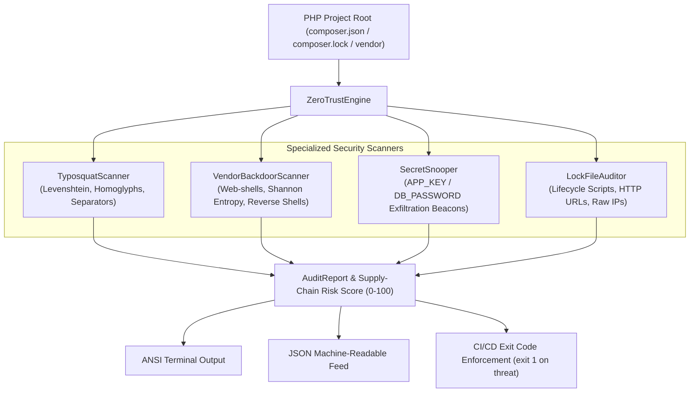

# 🛡️ Composer-Audit-ZeroTrust

<div align="center">

```
  ██████╗ ███████╗██████╗  ██████╗     ████████╗██████╗ ██╗   ██╗███████╗████████╗
  ╚════██╗██╔════╝██╔══██╗██╔═══██╗    ╚══██╔══╝██╔══██╗██║   ██║██╔════╝╚══██╔══╝
   █████╔╝█████╗  ██████╔╝██║   ██║       ██║   ██████╔╝██║   ██║███████╗   ██║   
  ██╔═══╝ ██╔══╝  ██╔══██╗██║   ██║       ██║   ██╔══██╗██║   ██║╚════██║   ██║   
  ███████╗███████╗██║  ██║╚██████╔╝       ██║   ██║  ██║╚██████╔╝███████║   ██║   
  ╚══════╝╚══════╝╚═╝  ╚═╝ ╚═════╝        ╚═╝   ╚═╝  ╚═╝ ╚═════╝ ╚══════╝   ╚═╝   
```

**Zero-Trust Supply-Chain Security & Typosquatting Auditor for Composer**

[](https://www.php.net/)
[](LICENSE)
[](tests/)
[](#)
[](action.yml)

[Features](#-key-features) •
[Architecture](#-architecture) •
[Quickstart](#-quickstart) •
[GitHub Action](#-github-actions-cicd-integration) •
[CLI Reference](#-cli-command-reference) •
[Threat Models](#-detected-threat-vectors)

</div>

---

### ⚠️ The Problem: Modern PHP Supply-Chain Attacks

Composer and Packagist are the backbone of modern PHP development. However, dependency attacks in 2024–2026 have escalated dramatically:
1. **Typosquatting & Homoglyphs**: Threat actors register lookalike packages (e.g. `guzlehttp/guzzle`, `symfoni/http-foundation`, or Cyrillic homoglyph `lаravel/framework`) that clone popular libraries but bundle hidden malware.
2. **Backdoored Packages & Maintainer Hijacking**: Attackers compromise abandoned or popular packages and inject obfuscated PHP web-shells (`eval(base64_decode(...))`, high-entropy binary blobs) into `vendor/`.
3. **Secret Exfiltration Beacons**: Malicious dependencies read `getenv('APP_KEY')`, `$_ENV['DB_PASSWORD']`, and AWS keys, quietly exfiltrating them via HTTP/DNS beacons to attacker servers.
4. **Dangerous Lifecycle Scripts**: Compromised packages execute unauthorized `post-install-cmd` shell commands (`curl ... | bash`) directly during `composer install`.

Traditional tools (`composer audit`) only check for known disclosed CVE IDs in a central advisory database—**they cannot detect zero-day backdoors, typosquatters, or malicious payload code inside vendor/**.

---

### 💡 The Solution: Composer-Audit-ZeroTrust

**Composer-Audit-ZeroTrust** operates on a **Zero-Trust heuristic philosophy**:
* **Never Trust Dependencies**: It statically parses `composer.json`, `composer.lock`, and all files in `vendor/`.
* **Typosquatting Intelligence**: Detects Levenshtein distance, Damerau transpositions, homoglyphs, and deceptive separator mimicking against canonical PHP packages.
* **Vendor Backdoor & Web-Shell Hunter**: Scans AST and regex heuristics for eval-unpackers, reverse shells, and high Shannon entropy packed blobs.
* **Secret Theft Detection**: Traces unauthorized reads of `APP_KEY`, `DB_PASSWORD`, and API keys coupled with outbound network beacons (`curl`, sockets, DNS).

---

### 🏛️ Architecture



---

### ⚡ Quickstart

#### 1. Global Installation via Composer:
```bash
composer global require anton-barinov/composer-audit-zerotrust
```

#### 2. Run Instant Scan:
```bash
# Scan current project:
composer-zerotrust scan .

# Scan specific directory and emit JSON:
composer-zerotrust scan /var/www/my-app --json
```

---

### 🤖 GitHub Actions CI/CD Integration

Prevent malicious packages and web-shells from ever reaching production. Add this step to your `.github/workflows/security.yml`:

```yaml
name: Supply Chain Security Audit

on: [push, pull_request]

jobs:
  zerotrust-audit:
    runs-on: ubuntu-latest
    steps:
      - name: Checkout code
        uses: actions/checkout@v4

      - name: Setup PHP
        uses: shivammathur/setup-php@v2
        with:
          php-version: '8.2'

      - name: Run Composer Zero-Trust Audit
        uses: Anton-Barinov/Composer-Audit-ZeroTrust@main
        with:
          path: '.'
          fail-on: 'CRITICAL'
```

---

### 💻 CLI Command Reference

```bash
# 1. Full supply-chain audit (typosquatting + vendor/ + lockfile)
composer-zerotrust scan [path]

# 2. Check exclusively for typosquatted and homoglyph packages
composer-zerotrust typosquat [path]

# 3. Deep heuristic scan of vendor/ for web-shells and obfuscated blobs
composer-zerotrust vendor-inspect [path]

# 4. Strict CI/CD pipeline mode (fails on CRITICAL findings)
composer-zerotrust ci [path] --fail-on=CRITICAL

# 5. Output results in machine-readable JSON format
composer-zerotrust scan . --json
```

---

### 🎯 Detected Threat Vectors

| Threat Vector | Severity | Risk Score | Description |
|---|---|---|---|
| `HOMOGLYPH_IMPERSONATION` | **CRITICAL** | **+45** | Visual spoofing using Cyrillic/Greek characters imitating legitimate packages (e.g. `lаravel/framework`). |
| `TYPOSQUAT_VENDOR_NAME` | **CRITICAL** | **+40** | Impersonation of legitimate vendor namespaces (e.g. `guzlehttp/guzzle`, `symfoni/console`). |
| `TYPOSQUAT_PACKAGE_NAME` | **CRITICAL** | **+40** | Typosquatting target package names within valid vendors (e.g. `monolog/monologg`). |
| `EVAL_BASE64_OBFUSCATION` | **CRITICAL** | **+50** | Dynamic code execution via decompressors/unpackers (`eval(base64_decode(...))`, `gzinflate`). |
| `SECRET_EXFILTRATION_BEACON` | **CRITICAL** | **+50** | Reading `APP_KEY`, `DB_PASSWORD`, or AWS secrets combined with outbound network transmission. |
| `BASH_DEV_TCP_REVERSESHELL` | **CRITICAL** | **+50** | Interactive reverse shell commands (`/dev/tcp/`, `nc -e /bin/sh`). |
| `DANGEROUS_LIFECYCLE_SCRIPT` | **CRITICAL** | **+50** | Dependencies executing unverified `curl \| bash` or powershell commands in post-install scripts. |
| `SUSPICIOUS_HIGH_ENTROPY_BLOB`| **HIGH** | **+25** | Encrypted or packed payloads with Shannon entropy > 5.6 bits/char. |
| `INSECURE_HTTP_DIST_URL` | **HIGH** | **+30** | Dependencies downloaded via unencrypted plain HTTP (vulnerable to MitM tampering). |
| `RAW_IP_DOWNLOAD_SOURCE` | **CRITICAL** | **+45** | Dependencies fetched directly from raw IP addresses rather than official repos. |

---

### ⚙️ Configuration (`composer-zerotrust.json`)

Customize thresholds and manage whitelisted internal packages:

```json
{
  "whitelist": [
    "acme/internal-auth",
    "mycompany/private-utils"
  ],
  "ignore_paths": [
    "vendor/acme/legacy-helper"
  ],
  "entropy_threshold": 5.6,
  "max_typosquat_distance": 2
}
```

---

### 🔗 Related Open-Source Projects by Anton Barinov

- **[Franken-Leak-Hunter](https://github.com/Anton-Barinov/Franken-Leak-Hunter)**: Memory leak and cross-request state pollution detector for FrankenPHP, RoadRunner, and Laravel Octane.
- **[EOL-PHP-Armor](https://github.com/Anton-Barinov/EOL-PHP-Armor)**: 1-line automated security hub & hotpatching engine for EOL PHP (5.4–8.1).
- **[php2shell-patches](https://github.com/Anton-Barinov/php2shell-patches)**: Backported C-patches for CVE-2026-109618 / CVE-2026-109619.
- **[PHP-Hardening-Kit](https://github.com/Anton-Barinov/PHP-Hardening-Kit)**: Modular defense-in-depth runtime WAF security kit for PHP.
- **[EOL-PHP-SecAuto](https://github.com/Anton-Barinov/EOL-PHP-SecAuto)**: Hardened Dockerfile generator for legacy PHP runtimes.
- **[OpenCart-MCP](https://github.com/Anton-Barinov/OpenCart-MCP)**: Model Context Protocol (MCP) server for OpenCart 2.x, 3.x, and 4.x.

---

### 📄 License

This project is open-sourced under the [MIT License](LICENSE) — created and maintained by **Anton Barinov**.
Community contributions, PRs, and security research disclosures are warmly welcomed!
